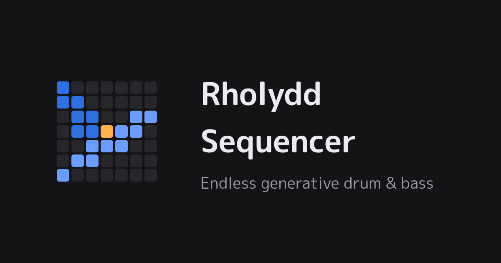

# Rholydd Sequencer



## 概要

Rholydd Sequencer（発音：/ˈr̥ɔlɨð ˈsiːkwənsə/）は、パラメーターを設定するだけでドラムンベースのビートをランダムに展開しながら永久に鳴らし続ける、ブラウザ向けの生成シーケンサーです。完全なランダムではなく、2bar・8bar・32bar・サイクルのそれぞれの単位でまとまりのある展開になるよう変化率を制御します。

**URL**: <https://gh.double-oxygen.net/rholydd-sequencer/>

名前の Rholydd は、ニシブッポウソウ（英名 roller）のウェールズ語名です。休みなく生成される音楽から渡り鳥を、ドラムンベースのサブジャンル rollers から roller を連想しました。

## 特徴

- **永続的な音楽再生**: 再生ボタンを押せば、止めるまで新しいパターンを生成し続けます。
- **階層変化**: 2bar の基本ループ、8bar のセクション、32bar のフレーズという3階層で、変化の種類と量を使い分けます。各区間を、基準となる区間に対する関係（反復・変奏・転換）として決め、反復は同じ形で再現し、変奏と転換で要所に変化を生みます。
- **展開の起伏**: 128〜192bar のサイクルでイントロ・ビルド・ドロップ・ブレイクダウンを巡り、ライザーやインパクトなどの FX で切り替わりを演出します。サイクル内では主題を共有し、2回目のドロップで同じ主題が戻ってきます。イントロの最初の8bar に鳴るドラムとパートが入る順も、サイクルごとに変わります。
- **DnB らしさの維持**: ステップごとの重み表とパートごとの変わりやすさにより、ランダムでもジャンルの文法を崩しません。
- **メディア操作**: メディアキーや OS のロック画面・通知から、再生・一時停止・停止できます。
- **英語の画面**: ブラウザの言語が日本語でなければ、画面を英語で表示します。
- **ホーム画面への追加とオフライン**: ブラウザのメニューからホーム画面やアプリの一覧に追加できます。一度開いた端末なら、オフラインでも開いて再生できます。新しい版は、ページのタブをすべて閉じて開き直したときから使われます。
- **再現性**: シードを保存すれば、同じ展開をもう一度聴くことができます。`?seed=12345` のように URL で初期シードを指定でき、右上の共有ボタンから、聴いている展開のシードを含めた URL をコピーできます。

## 対応環境

| ブラウザ | 環境 |
| --- | --- |
| Chrome・Edge | デスクトップの最新版（Edge は Chrome と同じ Chromium で動くため、個別には確かめていません） |
| Firefox | デスクトップの最新版 |
| Safari | macOS・iOS の最新版 |
| Chrome | Android の最新版 |

Web Audio API と AudioWorklet が必要です。オフラインで開くには、Service Worker が必要です（プライベートウィンドウなど、使えない環境ではオンラインでだけ開けます）。

**ブラウザごとの制約**

- **iOS の Safari**: 画面をロックしたときと、ほかのアプリやホーム画面に切り替えたときは、音が止まり一時停止になります。再開ボタンか、ロック画面の再生ボタンで続きから再開できます（ロック中も鳴ります）。消音のスイッチは影響しません。
- **Safari（macOS）**: 既定の設定では Tab キーでボタンに移れません。キーボードだけで操作するには、Safari の設定の「詳細」で Tab キーで各項目を強調表示する設定を有効にするか、Option + Tab を使ってください

## 技術スタック

| 領域 | 採用技術 | 理由 |
| --- | --- | --- |
| 言語 | TypeScript | イベントやコンテキストの型を厳密に定義し、不正な状態を型で表せないようにするため |
| ビルド | Vite | 開発サーバーが速く、静的アセットと AudioWorklet の扱いが簡単なため |
| 音声 | Tone.js（Web Audio API 上） | Transport による先読みの予約と、合成音源・エフェクトをそのまま使えるため |
| タイマー | Tone.js の Worker のクロック | メインスレッドの負荷でテンポが揺れるのを防ぐため |
| 乱数 | 自前の sfc32（シードの派生は splitmix32） | 環境によらない再現性と、用途ごとのシードの派生のため |
| UI | フレームワークなしの TypeScript、Lucide のアイコン | 画面の部品が少なく、フレームワークが要らないため |
| テスト | Vitest、Playwright、axe | 生成を音声なしで単体テスト・統計検証し、画面をブラウザで確かめるため |
| CI/CD | GitHub Actions、GitHub Pages | プルリクエストごとにテストし、main を自動で配布するため |

## ディレクトリ構成

何を鳴らすか（生成）といつ鳴らすか（再生）をディレクトリで分けています。生成は音を出さず、イベントの列だけを返します。

```
rholydd-sequencer/
├── public/
│   ├── samples/drums/         # kick, snare, hat, ghost の WAV（tools/make-samples.ts で合成した自作の音）
│   └── icons/                 # アイコンの元の SVG と、そこから tools/make-icons.ts で描いた PNG
├── src/
│   ├── main.ts                # 画面の組み立てと再生の操作
│   ├── service-worker.ts      # オフラインで開くためのサービスワーカー
│   ├── app-name.ts            # アプリの名前
│   ├── units.ts               # brand 型の基盤、0〜1 の値
│   ├── random/rng.ts          # シード付きの乱数、シードの派生
│   ├── structure/             # コンダクター、形式、アレンジとシーン、エネルギー、コードと進行、キー、音色の選択、調整用の数値
│   ├── generators/            # アンサンブル、ドラム、サブベース・リースベース・スタブ・パッド、選別と溜め、FX のイベント
│   ├── engine/                # トランスポート、一時停止と再開、音の経路、チャンネル、音源、FX、音色の表、オートメーション、ダッキング、クリップの検出
│   ├── params/                # パラメーター、ミキサー、設定ファイル、クエリ文字列
│   └── ui/                    # 再生の操作、位置の表示、シーケンサー、スペクトラムアナライザー、メニュー、パネル、ミキサー、共有、メディア操作、スタイル
├── tools/
│   ├── simulate.ts            # 音声なしの長時間の生成と統計（集計と整形は simulation/）
│   ├── make-samples.ts        # ドラムサンプルの合成
│   ├── make-icons.ts          # アイコンと共有用の画像を PNG に描く
│   ├── page-meta.ts           # 共有したリンクのプレビューのメタデータ
│   ├── web-app.ts             # マニフェストとサービスワーカーを作る
│   └── base-path.ts           # 配布する base path
├── tests/                     # 単体テスト（generation・playback・interface・quality）
├── e2e/                       # E2E テスト（Playwright）
├── docs/                      # 仕様の文書
├── config.example.json        # 設定ファイルの全キーと既定値
└── .github/workflows/ci.yml   # CI/CD
```

## セットアップ

Node.js 24.2 以上が必要です。

```bash
git clone https://github.com/Double-oxygeN/rholydd-sequencer.git
cd rholydd-sequencer
npm install
npm run dev
```

E2E テストを動かすときは、`npx playwright install` でブラウザをインストールしてください。

**スマートフォンによる動作検証**: 音の処理（AudioWorklet）は安全な接続（https か localhost）でしか動かないので、`npm run dev -- --host` で開いた LAN の http のアドレスでは起動しません。

- Android: USB でつなぎ、`adb reverse tcp:5173 tcp:5173` を実行してから、端末の Chrome で `http://localhost:5173/` を開く
- iOS（Android でも可）: `npm run cert` で証明書を作り、表示された `rootCA.pem` を端末にインストールして信頼する（iOS は「設定 → 一般 → 情報 → 証明書信頼設定」で有効にする）。`npm run dev:https` を起動し、表示された URL を開く。LAN のアドレスが変わったら `npm run cert` をやり直す

## 設定ファイル

`public/config.json`（配布するときは `index.html` と同じ場所の `config.json`）を置くと、ページを開いたときに読み込み、パラメーターとミキサーの初期値や、生成と音の調整用の数値を上書きします。書き方は `config.example.json` を参照してください。書いたキーだけが上書きされ、ファイルがない場合や書かれていないキーはコードの既定値を使います。型や範囲の合わない値は無視し、ブラウザのコンソールに警告を出します。同じシードでも、設定ファイルの生成の数値が違えば別の展開になります。公開しているページには設定ファイルを置いていません。

## 開発コマンド

| コマンド | 内容 |
| --- | --- |
| `npm run dev` | 開発サーバーを起動 |
| `npm run cert` | LAN の実機で試すための証明書を `.cert/` に作る（[mkcert](https://github.com/FiloSottile/mkcert) が必要） |
| `npm run dev:https` | 開発サーバーを LAN に HTTPS で公開する（先に `npm run cert`） |
| `npm run build` | 配布用のビルド（base path は `/rholydd-sequencer/`。`npm run build -- --base /path/` で変えられるが、共有したリンクのプレビューの URL は `package.json` の `homepage` を指したまま） |
| `npm run preview` | ビルドしたページを配る |
| `npm test` | 単体テスト |
| `npm run e2e` | ビルドしてから E2E テスト（Chromium・Firefox・WebKit） |
| `npm run typecheck` | 型検査 |
| `npm run simulate -- --bars 4096 --seed 42` | 音声なしで長時間生成し、密度・反復率・進行・各パート・サイクルとシーン・ドロップの入り方・移調・音色・FX の統計を出力（`--m2` `--m8` `--m32` `--energy` `--fill` `--initial-key` `--json` も指定可。`--config <パス>` で設定ファイルを読む） |
| `npm run samples` | ドラムサンプルを `public/samples/drums/` に合成し直す |
| `npm run icons` | `public/icons/icon.svg` から、アイコンと共有用の画像の PNG を `public/icons/` に描き直す（Playwright の Chromium を使う） |

## 仕様の文書

仕様は `docs/` に領域ごとにまとめています。入口は [docs/README.md](./docs/README.md) です。予定と変更の履歴は GitHub の Issues と Releases で管理します。

## ライセンス

Apache License 2.0。全文はリポジトリ直下の LICENSE ファイルを参照してください。

ドラムサンプル（`public/samples/drums/`）は、`tools/make-samples.ts` で合成した自作の音です。アイコンと共有用の画像（`public/icons/`）は、自作の SVG と、そこから `tools/make-icons.ts` で描いた PNG です。どちらも外部の素材を使っていないので、リポジトリと同じ Apache License 2.0 で配布します。
